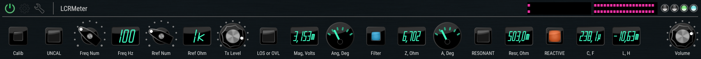
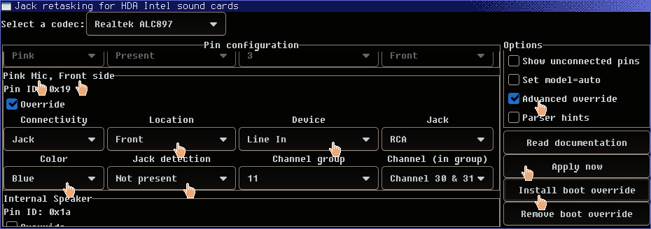
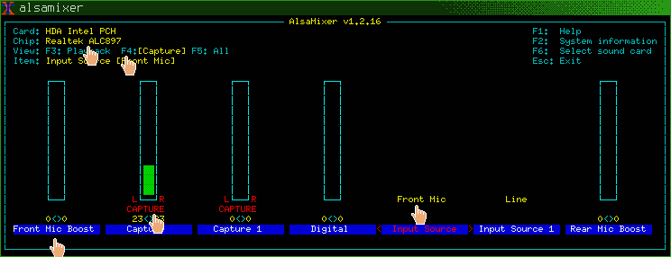

# lcrmeter.dsp

lcrmeter.dsp is LCR Meter using Linux, sound card, LV2, and JACK
---

While your bench top setup probably equipped with good LCR Meter already, still it's often not available like at field tests, or at remote sites. If regular desktop PC with Linux and sound card available, it can be used instead. Another motivation is to rise interest to learn how measurements are made, and to see and feel in your hands what limits its precision and range. 

Note that we will need blue stereo Line input connector. **It is always of great importance to select motherboards with such connector**. 

I also assume that you are familiar with `alsamixer`, `jack`, and `LV2` plugins using `Carla`.

Please read [^1] to get an idea how we can built our meter unit. Thanks to Tektronix for sharing their efforts!

My LCR Meter uses differential signalling. Hardware required is two resistors (let's start at _1k Ohm_ value) between Line-in and Headphone out: `OutL [1k] InL`, `OutR [1k] InR`. Connect DUT (device under test) to inputs: `InL [DUT] InR` (later; now we leave it open circuit).

To use this `.dsp` code, install [carla](https://github.com/twonoise/carla-patches) and `faust`. **Note** that this Carla tree is equipped with display buttons and meters, not merged to main tree yet.

Compile & install the `LCRMeter` code, as shown at its head.

Then load `LCRMeter` plugin with Carla, and connect its stereo input and output to system sound output and input, either with Carla `Patchbay` tab, or `Graph` of `QJackCtl`. Other **plugin hosts** are can be used, when you are familiar with them.

Next, using `alsamixer`, set Master, PCM and Headphone level to 100%. At inputs tab (`F4`), set Line-in gain to minimal position when _OVL_ of `LCRMeter` still lit. Then, fine tune _TX Level_ of `LCRMeter` to be just a bit below of level when _OVL_ goes out. This gives most powerful output level, yet have non overloaded signal path.

Now it's time to use `Calib` button of `LCRMeter`:
* Open the circuit (DUT disconnected);
* Wait few seconds;
* Press `Calib` to be ON;
* Connect `Rref` resistor as DUT;
* Wait few more seconds;
* Press `Calib` again;
* See UNCAL alarm goes out;
* Disconnect `Rref` resistor.

Calibration is of key importance, as we do not have 2nd stereo line input to connect it as `Va1` meter (see article). Calibration latches:
* amplitude and
* phase of currently selected frequency;
* internal output resistance of sound card,

and uses these values as a reference. Phase here includes all propagation delays between output and input, include codec, driver, JACK buffers. Calibration effectively cancels it all, but at current frequency only. Recalibrate when frequency is changed.

Now it's time to measure some electronic parts, and compare results with DT-9935 or other industrial LCR meter. Please report results here. **Discharge capacitor before connect!**

Note that `.dsp` code also acts as documentation, and it is _intended_ to user enhancements: 
* _Example_. Want a cat eye as magnitude meter? Replace `mag_meter` limits from `0.0, 9.999` to `0.0, 1.0`.

You can see the system diagram at [faustide.grame.fr](https://faustide.grame.fr/). Put our code there, run it, find `Diagram` tab. Dark blue submodules are clickable.

SNR and EMI
-----------
I have used differential signalling. It doubles amplitude, halves input noise power of ADC, and greatly reduces EMI. That's why stereo input and output need.

There is coherent receiver with 3 stage, 3.3 Hz BW low pass filters. Squeezing it even narrower, produces more ringing and longer settle time, but welcome to try. I also provide video filter. Note that it's switch button is three positional.

Q & A
=====
Calibration drift
-----------------
If calibration not stays for long, and need to re-calibrate every few minutes, it is probably Mic input used. Please try to use Blue Stereo Line In input.

Mic In vs Line In
-----------------
Sometimes it is possible to use `hdajackretask` magic to turn pink mono Mic connector into stereo Line In input (separate article, TODO):

Using retasked front pink input, together with phones output, allows to use only front panel connectors, which is great for schools or education, _but_, using mic input gives bad effects of drift values, due to AGC and non precision signal path for it inside of codec.

Input (parallel) resistance of such mic input will be way worse (lower) than blue Line In, thus it is rarely possible to have `Rref` above ~10k Ohm.

Line Out vs HP Out
------------------
If headphone output is not available, stereo lightgreen Line Out can be used. Do not forget to enable it with `alsamixer`. 
* As it have increased internal output resistance, there is better not to use `Rref` less than 1k Ohm. There is also low frequency limit, precision will be degraded below 200 Hz. Values are depends on codec and motherboard; ALC898 output resistance specs are: typ. 2 Ohm front headphone, 200 Ohm line out.
* It also have reduced series capacitance. While it is acceptable for regular use with 47k, min. 10k Ohms load, it gives noticeable phase shift at heavier loads like 1k Ohm, and this phase shift is _can not be cancelled by calibration_, as it is load dependent. It will be in order of 5 deg. at 1k Ohm and 100 Hz, you may note it after calibration (`Ang, Deg` value). Note that it is capacitive yet positive sign: it is due to it is _series_ capacitance.
  * At single frequency point, it probably can be cancelled with some extra series inductance.

Bugs
====
* <del>Small values (below ~0.001) are displayed incorrectly. Should be scaled with `milli` or `micro` suffix, like `k` or `M` with large ones. This is planned. This is about intermediate values, not the final result. Tooltip shows correct value.</del> Fixed.

TODO
====
Make all values well limited. It is important for any DSP to set strict boundaries of every signal.

LICENSE
=======
This manual for `LCRMeter`, together with its inlined pictures, are licensed under Creative Commons Attribution 4.0. You are welcome to contribute to the manual in order to improve it so long as your contributions are made available under this same license.

`LCRMeter` is MIT license.

[^1]: [Tek appnote 75W-28152-2 "Capacitance and Inductance Measurements Using an Oscilloscope and a Function Generator" Rev. 02.2022](https://map-assets.tek.com/map-assets/asean/PDF/75W281522CapacitanceandInductanceMeasurementsOscilloscopeFunctionGeneratorApplicationNote032023.pdf)
