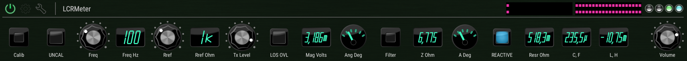
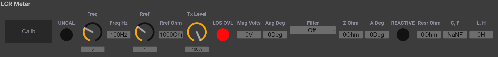
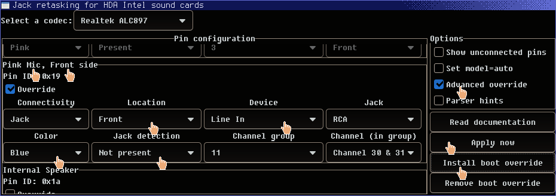
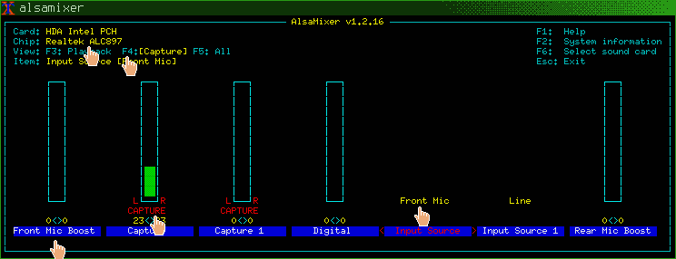
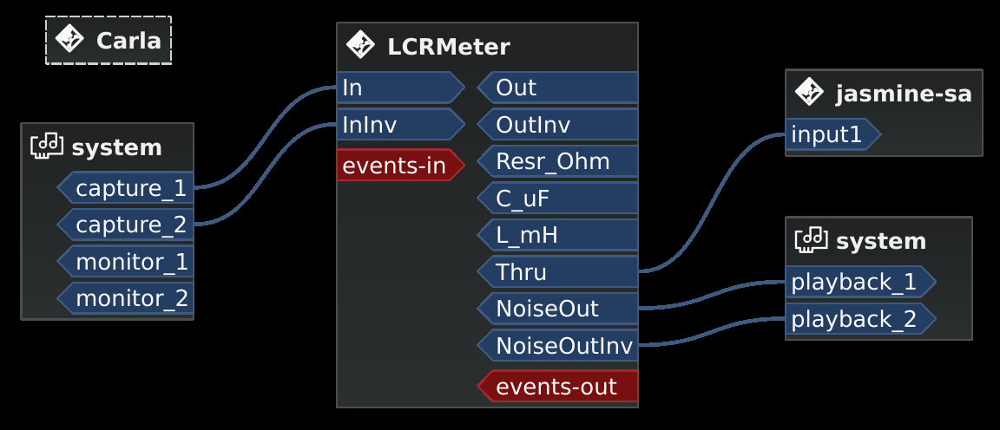
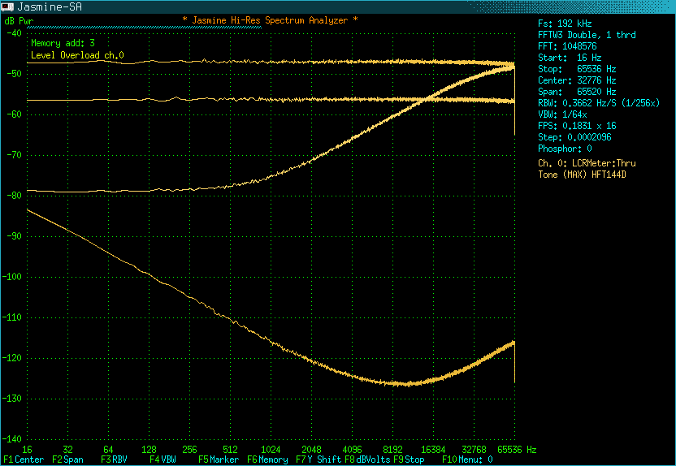

# lcrmeter.dsp

lcrmeter.dsp is LCR Meter using Linux, sound card, LV2, Faust, and JACK
---

While your bench top setup probably equipped with good LCR Meter already, still it's often not available like at field tests, or at remote sites. If regular desktop PC with Linux and sound card available, it can be used instead. Another motivation is to rise interest to learn how measurements are made, and to see and feel in your hands what limits its precision and range. 

Note that we will need blue stereo Line input connector. 
> [!Important]
> **It is always of great importance to select motherboards with Blue stereo Line-In connector**. 

I also assume that you are familiar with `alsamixer`, `jack`, and `LV2` plugins using `Carla`.

Please read [^1] to get an idea how we can built our meter unit. Thanks to Tektronix for sharing their efforts!

My LCR Meter uses differential signalling. Hardware required is two resistors (let's start at _1k Ohm_ value) between Line-in and Headphone out: `OutL [1k] InL`, `OutR [1k] InR`. Connect DUT (device under test) to inputs: `InL [DUT] InR` (later; now we leave it open circuit).

To use this `.dsp` code, install [carla](https://github.com/twonoise/carla-patches) and `faust`. **Note** that this Carla tree is equipped with display buttons and meters, not merged to main tree yet. To get larger displays: `QT_SCALE_FACTOR=2 carla`. To set font for labels: `qt5ct` or `qt6ct`.

Compile & install the `LCRMeter` code, as shown at its head.

Then load `LCRMeter` plugin with Carla, and connect its stereo input and output to system sound output and input, either with Carla `Patchbay` tab, or `Graph` of `QJackCtl`. Other **plugin hosts** are can be used, when you are familiar with them.

Next, using `alsamixer`, set Master, PCM and Headphone level to 100%. At inputs tab (`F4`), set Line-in gain to minimal position when _OVL_ of `LCRMeter` still lit. Then, fine tune _TX Level_ of `LCRMeter` to be just a bit below of level when _OVL_ goes out. This gives most powerful output level, yet have non overloaded signal path. Other method is possible: set Line-in gain a bit below _OVL_, then one does not need to tune _TX Level_ of LCRMeter.

Now it's time to use `Calib` button of `LCRMeter`:
* Open the circuit (DUT disconnected);
* Wait few seconds;
* Press `Calib` to be ON;
* Connect `Rref` resistor as DUT;
* Wait few more seconds;
* Press `Calib` again;
* See UNCAL alarm goes out;
* Disconnect `Rref` resistor.

Calibration is of key importance, as we do not have 2nd stereo line input to connect it as `Va1` meter (see article). Calibration latches:
* amplitude and
* phase of currently selected frequency;
* internal output resistance of sound card,

and uses these values as a reference. Phase here includes possible inversion due to swap of L, R wires, as well as, all propagation delays between output and input, include codec, driver, JACK buffers. Calibration effectively cancels it all, but at current frequency only. Recalibrate when frequency is changed.

Now it's time to measure some electronic parts, and compare results with DT-9935 or other industrial LCR meter. Please report results here.
> [!WARNING]
> **Discharge capacitor before connect!**

Note that `.dsp` code also acts as documentation, and it is _intended_ to user enhancements: 
* _Example_. Want a cat eye as magnitude meter? Replace `mag_meter` limits from `0.0, 9.999` to `0.0, 1.0`.

You can see the system diagram at [faustide.grame.fr](https://faustide.grame.fr/). Put our code there, run it, find `Diagram` tab. Dark blue submodules are clickable. Btw, it should be possible to work with it directly in browser. I am did not see stereo duplex sound i/o working with browsers these days, yet maybe you will be more happy.

SNR and EMI
-----------
I have used differential signalling. It doubles amplitude, halves input noise power of ADC, and greatly reduces EMI. That's why stereo input and output need. 

There is coherent receiver with 3 stage, 3.3 Hz BW low pass filters. Squeezing it even narrower, produces more ringing and longer settle time, but welcome to try. I also provide video filter. Note that it's switch button is three positional.

Q & A
=====

Ground wire
-----------
One may note that ground wire of connectors is not used, which looks somewhat irregular. Yes, ground not need for measurements, but it is better to still use it to connect to some metal piece at work area. Touch it with finger before touching I/O will save codec from ESD damage.

Calibration drift
-----------------
If calibration not stays for long, and need to re-calibrate every few minutes, it is probably Mic input used. Please try to use Blue Stereo Line In input.

Mic In vs Line In
-----------------
Sometimes it is possible to use `hdajackretask` magic to turn pink mono Mic connector into stereo Line In input (separate article, TODO):

Using retasked front pink input, together with phones output, allows to use only front panel connectors, which is great for schools or education, _but_, using mic input gives bad effects of drift values, due to AGC and non precision signal path for it inside of codec.

Input (parallel) resistance of such mic input will be way worse (lower) than blue Line In, thus it is rarely possible to have `Rref` above ~10k Ohm.

If you use **Audacity**, note that it can switch alsamixer's inputs, as well as, may or may not restore it at exit.

Line Out vs HP Out
------------------
If headphone output is not available, stereo lightgreen Line Out can be used. Do not forget to enable it with `alsamixer`. 
* As it have increased internal output resistance, there is better not to use `Rref` less than 1k Ohm. There is also low frequency limit, precision will be degraded below 200 Hz. Values are depends on codec and motherboard; ALC898 output resistance specs are: typ. 2 Ohm front headphone, 200 Ohm line out.
* It also have reduced series capacitance. While it is acceptable for regular use with 47k, min. 10k Ohms load, it gives noticeable phase shift at heavier loads like 1k Ohm, and this phase shift is _can not be cancelled by calibration_, as it is load (DUT) dependent. It will be in order of 5 deg. at 1k Ohm and 100 Hz, you may note it after calibration, using `Rref` as DUT (`Ang, Deg` value). Note that it is capacitive yet positive sign: it is due to it is _series_ capacitance.
  * At single frequency point, it probably can be cancelled with some extra series inductance.

How to calibrate at several frequencies?
---------------------------------------
Current `Faust` does not support arrays, or I can't figure out how to use it; so, calibration is lost at frequency change. You may use several instances of our Meter, using `Carla`:
* Calibrate at one frequency, as usual.
* Turn off TX power with rightmost `Volume` knob, either witl `Left click`, or, `Mouse hover` + `Space`; or, use crossed Speaker icon at toolbar. Knob should be 'Mute' labeled now.
* Add another LCRMeter. Connect I/O to same system ports, i.e., in parallel to Meter we already have.
* Switch it to another frequency, then calibrate.
* Now we able to hot switch frequency with `Volume` knobs.

My meter looks different
------------------------
Check if your Carla is from [mentioned code](https://github.com/twonoise/carla-patches). Use `Disco glasses` icon, or `Right click` then `Change theme...`, select `Tube`. 

Top right VU meters are unstable
--------------------------------
Settings `->` Configure Carla `->` Interface refresh interval, select some 19 ms or similar not interferes with frequency.

What's next
===========
Same not-so-complicated hardware can be used for way more things, along LCR Meter. Example is Bode plots (amplitude frequency responce graphs) of same DUTs (measured with LCR Meter), as well as cables, transformers, and other passive components. Time domain reflectometry is also possible, but, it will be too coarse (miles).

Sadly, [JACK tools](https://github.com/jackaudio/jack-example-tools/tree/main/example-clients) are does not provides code which records and plays at same time (or at least play only). As this is fragile realtime component, it can not be created by me. So direct Bode plots, with coherent frequency stimulus and receiver, as LCR Meter have, are impossible in its most simple form. Faust currently does not provide simple Graph primitive, as this is not defined at sound plugins specs. So only we can do to keep it simple and understandeable, is to use incoherent measurements (more precisely - just _estimations_) plots, which is done with wideband, max possible power white noise source. Dynamic range and sensitivity are both way too worse than coherent method. Well, let's try.

One may note that our Meter provides extra differential white noise output. Connect it, instead of regular output of LCR Meter, to system output:

At other side, we need some receiver which can plot something. I will use [Jasmine spectrum analyzer](https://github.com/twonoise/jasmine-sa). We will need experimental `Log X Scale` mode of it:

    jasmine-sa LCRMeter:Thru -h 16,16384  # or ... -h 16,65536,12

Log frequency scale is needed to better represent reactive components (DUTs) behaviour. You may also need to reduce Spectrum analyzer reference bandwidth (RBW, `F3`) and/or to use video filter (VBW, `F4`), as well as, stretch Y axis twice (`F7`) and/or shift it (`F8`). Then connect various DUTs, and compare result with plots at Tektronix article, to guess how to better measure it (select `Rref` and frequency for LCR Meter), as well as, find some impurities in DUTs, like resonances.

_On photo:_ Ref level, and three DUTs, using 1k Ohm `Rref`: 
* Rref itself used as DUT;
* 10 mH, high ESR inductor;
* 220 uF capatitor, connected with way too long probes (~4 ft each).

Bugs
====
* <del>Small values (below ~0.001) are displayed incorrectly. Should be scaled with `milli` or `micro` suffix, like `k` or `M` with large ones. This is planned. This is about intermediate values, not the final result. Tooltip shows correct value.</del> Fixed.

TODO
====
Make all values well limited. It is important for any DSP to set strict boundaries of every signal.

LICENSE
=======
This manual for `LCRMeter`, together with its inlined pictures, are licensed under Creative Commons Attribution 4.0. You are welcome to contribute to the manual in order to improve it so long as your contributions are made available under this same license.

`LCRMeter` is MIT license.

[^1]: [Tek appnote 75W-28152-2 "Capacitance and Inductance Measurements Using an Oscilloscope and a Function Generator" Rev. 02.2022](https://map-assets.tek.com/map-assets/asean/PDF/75W281522CapacitanceandInductanceMeasurementsOscilloscopeFunctionGeneratorApplicationNote032023.pdf)
